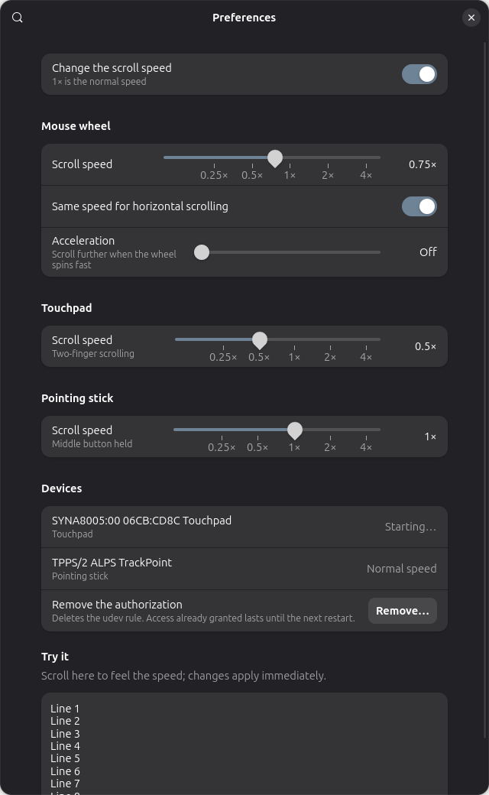

# Scroll Speed

Régler la vitesse de défilement sous GNOME, le réglage qui manque à côté de
« Vitesse du pointeur » : la molette de la souris, le défilement à deux doigts
du pavé tactile et le défilement au bouton du milieu d'un TrackPoint, chacun
plus lent ou plus rapide. La molette a aussi une vitesse horizontale séparée
et une accélération optionnelle quand elle tourne vite. Fonctionne dans toutes
les applications, sous Wayland comme sous X11.

[English version](README.md)



État : 0.3, pour GNOME 51 (construit et testé sur Ubuntu 26.10). Toute la chaîne
est couverte par des tests automatiques sur de vrais périphériques noyau ; sur
du vrai matériel, elle n'a servi pour l'instant que sur le pavé tactile d'un
portable (voir [Ce qui est testé](#ce-qui-est-testé)). Les retours d'autres
machines sont bienvenus.

## Installation

Téléchargez `scroll-speed@griffit.gmail.com.shell-extension.zip` depuis la
[dernière version](https://github.com/d101c/scroll-speed/releases/latest),
puis :

```bash
gnome-extensions install --force scroll-speed@griffit.gmail.com.shell-extension.zip
```

(Depuis un clone, `./pack.sh` construit ce zip.) Il faut Python 3, présent sur
toutes les distributions GNOME.

Fermez la session puis rouvrez-la (Wayland ne peut pas charger une nouvelle
extension dans un Shell en cours d'exécution), activez *Scroll Speed*, ouvrez
ses préférences et :

1. cliquez une fois sur **Autoriser…** et saisissez votre mot de passe ;
2. déplacez un curseur **Vitesse de défilement** (ceux du pavé tactile et du
   TrackPoint apparaissent quand l'ordinateur en a un). Le changement est
   immédiat ; la zone *Essayer* en bas sert à le sentir.

Pour essayer sans fermer la session :

```bash
./try-now.sh 0.5
```

Le script demande la même autorisation si elle manque, puis divise par deux
la vitesse de défilement de la molette, du pavé tactile et du TrackPoint
jusqu'à Ctrl+C.

## Fonctionnement

```
périphérique ──► evdev (noyau) ──► assistant (capture + mise à l'échelle) ──► clone uinput ──► libinput ──► GNOME ──► applications
```

`extension/helper/scroll_speed_helper.py` (Python, bibliothèque standard
uniquement) capture chaque périphérique, crée un clone virtuel avec la même
identité, et retransmet tous les événements tels quels sauf ce qui fait
défiler :

- **Molette.** Les déplacements de molette sont multipliés par le facteur et
  émis au format haute résolution du noyau (120 unités par cran) : ×0,5 arrive
  donc aux applications comme un demi-cran, pas comme « un cran sur deux ».
  Les applications qui ne comprennent que les crans entiers en reçoivent un
  chaque fois qu'un cran complet s'est accumulé.
- **Pavé tactile.** Il n'y a pas d'événement de défilement à multiplier : le
  noyau ne donne que la position des doigts, et libinput fait défiler de la
  moyenne du mouvement de deux doigts. Tant que deux doigts exactement vont
  dans le même sens, l'assistant décale les deux positions transmises de
  (facteur − 1) × ce mouvement commun. La moyenne parcourt « facteur » fois la
  distance ; l'écart et l'angle entre les doigts, dont est fait un pincement,
  ne changent pas. Un doigt, trois doigts, un doigt qui bouge à côté d'un
  pouce posé et un cliquer-glisser sont transmis tels quels. Les 2 premiers
  millimètres d'un défilement aussi, pour que libinput distingue tapes,
  défilements et pincements exactement comme avant.
- **TrackPoint.** Le mouvement fait pendant que le bouton du milieu est
  maintenu, que libinput transforme en défilement, est multiplié par le
  facteur.

L'extension lance l'assistant, lui envoie les réglages au fil des changements
et l'arrête quand elle est désactivée. L'assistant s'arrête de lui-même si le
Shell disparaît, ce qui rend les périphériques. Un périphérique dont la
vitesse est 1× n'est pas touché du tout.

### L'autorisation

L'assistant doit lire les périphériques et en créer des virtuels.
**Autoriser…** installe `/etc/udev/rules.d/70-scroll-speed.rules` via polkit :

- accès à `/dev/uinput`, aux souris, aux pavés tactiles et aux TrackPoint pour
  l'utilisateur connecté sur le poste (`uaccess`, le mécanisme qu'udev emploie
  pour les manettes et les cartes son) ;
- les claviers physiques sont exclus des règles des nœuds d'événements :
  l'assistant ne les capture jamais (mais `/dev/uinput` lui-même est ouvert,
  voir ci-dessous) ;
- les clones retrouvent l'entrée de la base matérielle de la souris qu'ils
  reproduisent (DPI, marqueur trackball), donc le pointeur bouge exactement
  comme avant.

L'accès à `/dev/uinput` permet aux programmes de votre session de créer des
périphériques d'entrée ; les règles udev de Steam font de même. L'assistant tourne
en utilisateur, sans privilège. **Retirer…** dans les préférences supprime la
règle ; elle reste installée jusque-là, même après désinstallation de
l'extension. Une règle installée par la version 0.1
ne couvre que les souris : les préférences demandent alors d'autoriser une
fois de plus.

## Pourquoi pas une simple extension ?

C'est la première piste essayée, et elle est impossible sous GNOME 51 :

- Mutter remet l'événement de défilement au client Wayland *avant* que le code
  d'une extension ne s'exécute, et les événements livrés à une fenêtre
  n'atteignent jamais le JavaScript du Shell. Une extension ne peut ni les
  modifier ni même les voir.
- libinput sait mettre le défilement à l'échelle (profil d'accélération
  personnalisé, type « scroll »), mais Mutter ne transmet que la courbe de
  *déplacement du pointeur* de
  `org.gnome.desktop.peripherals.mouse custom-accel-config`.
- libinput 1.30 a des plugins Lua et Mutter 51 les charge depuis
  `~/.config/libinput/plugins`, ce qui ne demanderait aucun privilège, mais
  Ubuntu compile libinput sans Lua.

Le pavé tactile a bien une clé `scroll-speed` dans
`org.gnome.desktop.peripherals.touchpad`, mais Mutter 51 ne la lit pas.

Le défilement est donc mis à l'échelle sous le compositeur. Si Mutter expose un
jour la courbe de défilement, ou si les distributions activent les plugins
Lua, l'assistant pourra être remplacé sans toucher aux préférences.

## Limites

- Pavé tactile : défilement à deux doigts uniquement, pas le défilement au
  bord. Les pavés qui ne signalent pas chaque doigt séparément (anciens pavés
  « semi-mt ») sont laissés tels quels. Sur un geste très rapide avec un
  facteur supérieur à 1, l'accélération est plafonnée : libinput prendrait
  sinon le mouvement pour un défaut matériel et le jetterait.
- TrackPoint : un *glisser* au bouton du milieu est mis à l'échelle comme un
  défilement, l'assistant ne pouvant pas les distinguer.
- libinput ne filtre pas les rebonds des boutons d'un périphérique virtuel :
  une souris dont un bouton usé double-clique perd cette protection pendant
  que sa molette est mise à l'échelle.
- Un périphérique combiné clavier + souris qui apparaît comme un seul nœud est
  laissé tel quel (la règle ne donne aucun accès aux claviers).
- Un périphérique capturé par un autre programme (un remappeur) est ignoré,
  avec une nouvelle tentative toutes les 30 secondes.
- L'extension est désactivée sur l'écran de verrouillage, comme toute
  extension : le défilement y reprend sa vitesse normale.

## Ce qui est testé

`tests/run.sh` lance tout :

- 61 tests unitaires de la mise à l'échelle : la molette (restes, changements
  de sens, accélération, souris basse résolution), le pavé tactile
  (défilement, pincement, pouce posé, cliquer-glisser, trois doigts, doigt
  levé en plein défilement, limites que libinput impose aux mouvements
  brusques) et le TrackPoint ;
- 18 tests de bout en bout de l'assistant sur de vrais périphériques noyau :
  une fausse source créée avec uinput est capturée, clonée et mise à
  l'échelle, les réglages changent à chaud, le périphérique est rendu en
  réglage neutre (jamais au milieu d'un clic ou d'un toucher), à l'arrêt et
  sur SIGTERM, débranchement à chaud, un bouton maintenu ou un doigt posé
  retarde la capture, un second assistant refuse de démarrer ;
- tests unitaires de la logique des préférences, et de la règle udev exacte
  qu'écrit la commande d'installation (`udevadm verify`).

Vérifié à la main sur GNOME 51 :

- une souris virtuelle qui envoie 60/120 de cran fait défiler une fenêtre
  GTK 4 d'exactement 0,5 (12/120 donne 0,1 ; 240/120 donne 2) ;
- l'extension dans un Shell sans écran : assistant lancé, réglages transmis,
  arrêt à la désactivation, relance après un plantage ;
- la règle udev dans `udevadm test` : souris, pavé tactile, TrackPoint et
  uinput reçoivent l'accès, pas le clavier, un clone retrouve son
  `MOUSE_DPI` ;
- la fenêtre polkit et le défilement à deux doigts sur un vrai pavé tactile
  (ThinkPad, Synaptics I2C), depuis la fenêtre de préférences.

Pas encore testé sur du vrai matériel : une souris à molette et un TrackPoint.

`tests/prefs_preview.js` ouvre la fenêtre de préférences hors du Shell et peut
l'enregistrer en PNG.

## Désinstallation

Préférences › **Retirer…**, puis `gnome-extensions uninstall scroll-speed@griffit.gmail.com`.

## Licence

GPL-2.0-or-later.
