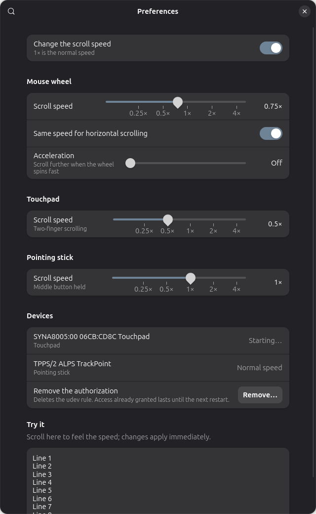

# Scroll Speed

Set the scroll speed on GNOME, the setting that is missing next to "Pointer
speed": the mouse wheel, two-finger scrolling on the touchpad and
middle-button scrolling on a pointing stick (TrackPoint), each slower or
faster. The wheel also gets a separate horizontal speed and optional
acceleration when it spins fast. It works in every application, on Wayland
and X11.

[Version française](README.fr.md)



Status: 0.3, for GNOME 51 (built and tested on Ubuntu 26.10). The whole chain is
covered by automated tests on real kernel devices; on physical hardware it has
only been used on one laptop touchpad so far (see
[What is tested](#what-is-tested)). Reports from other machines are welcome.

## Install

Download `scroll-speed@griffit.gmail.com.shell-extension.zip` from the
[latest release](https://github.com/d101c/scroll-speed/releases/latest), then:

```bash
gnome-extensions install --force scroll-speed@griffit.gmail.com.shell-extension.zip
```

(From a checkout, `./pack.sh` builds that zip.) It needs Python 3, which every
GNOME distribution ships.

Log out and back in (Wayland cannot load a new extension into a running
shell), enable *Scroll Speed*, open its preferences and:

1. click **Authorize…** once and type your password;
2. move a **Scroll speed** slider (the touchpad and pointing stick ones show
   up when the computer has one). The change applies immediately; the *Try it*
   area at the bottom is there to feel it.

To try it without logging out:

```bash
./try-now.sh 0.5
```

It asks for the same authorization if it is missing, then halves the scroll
speed of the wheel, the touchpad and the pointing stick until Ctrl+C.

## How it works

```
device ──► kernel evdev ──► helper (grab + rescale scrolling) ──► uinput clone ──► libinput ──► GNOME ──► apps
```

`extension/helper/scroll_speed_helper.py` (Python, standard library only)
grabs each device, creates a virtual clone with the same identity, and
forwards every event unchanged except what makes the view scroll:

- **Mouse wheel.** Wheel deltas are multiplied by the factor and sent in the
  kernel's high-resolution format (120 units per notch), so ×0.5 reaches
  applications as half a notch rather than "one notch out of two".
  Applications that only understand whole notches get one every time a full
  notch has accumulated.
- **Touchpad.** There is no scroll event to multiply: the kernel only reports
  where the fingers are, and libinput scrolls by the average motion of two
  fingers. While exactly two fingers move the same way, the helper shifts both
  reported positions by (factor − 1) × that common motion. The average moves
  `factor` times as far; the distance and angle between the fingers, which is
  what a pinch is made of, do not change. One finger, three fingers, a finger
  moving next to a resting thumb and a click-and-drag are forwarded as they
  are. The first 2 mm of a scroll are left alone too, so that libinput tells
  taps, scrolls and pinches apart exactly as before.
- **Pointing stick.** The motion made while the middle button is held, which
  libinput turns into scrolling, is multiplied by the factor.

The extension starts the helper, sends it the settings as they change, and
stops it when the extension is disabled. The helper exits by itself if the
shell goes away, which gives the devices back. A device whose speed is 1× is
not touched at all.

### The authorization

The helper needs to read the devices and to create virtual ones.
**Authorize…** installs `/etc/udev/rules.d/70-scroll-speed.rules` through
polkit:

- access to `/dev/uinput` and to the event nodes of mice, touchpads and
  pointing sticks for the user logged in on the seat (`uaccess`, the mechanism
  udev uses for joysticks and sound cards);
- physical keyboards are excluded from the event-node rules, so the helper
  never captures them (but `/dev/uinput` itself is open, see below);
- clones get the hardware-database entry of the mouse they mirror (DPI,
  trackball flag), so the pointer moves exactly as before.

Granting access to `/dev/uinput` lets programs of your session create input
devices; Steam's udev rules do the same. The helper runs as you, with no
privilege. **Remove…** in the preferences deletes the rule; it stays installed until then, even after the extension is
uninstalled. A rule installed by version 0.1 only covers mice: the
preferences then ask to authorize once more.

## Why not a plain extension?

That was the first thing tried, and it is not possible on GNOME 51:

- Mutter hands a scroll event to the Wayland client *before* extension code
  runs, and events delivered to a window never reach the shell's JavaScript at
  all. An extension can neither change nor even see them.
- libinput can scale scrolling (custom acceleration profile, scroll type), but
  Mutter only passes the *pointer motion* curve from
  `org.gnome.desktop.peripherals.mouse custom-accel-config`.
- libinput 1.30 has Lua plugins and Mutter 51 loads them from
  `~/.config/libinput/plugins`, which would need no privilege at all, but
  Ubuntu builds libinput without Lua.

The touchpad has a `scroll-speed` key in
`org.gnome.desktop.peripherals.touchpad`, but Mutter 51 does not read it.

So scrolling is rescaled below the compositor. If Mutter ever exposes the
scroll curve, or distributions enable Lua plugins, the helper can be replaced
without changing the preferences.

## Limits

- Touchpad: two-finger scrolling only, not edge scrolling. Touchpads that do
  not report each finger separately (old "semi-mt" pads) are left alone. On a
  fast flick with a factor above 1 the speed-up is capped, because libinput
  would otherwise take the motion for a hardware glitch and drop it.
- Pointing stick: a middle-button *drag* is rescaled like a scroll, since the
  helper cannot tell them apart.
- libinput does not debounce the buttons of a virtual device, so a mouse with
  a worn, double-clicking switch loses that protection while its wheel is
  rescaled.
- A combined keyboard-and-mouse device that shows up as a single node is left
  alone (the rule gives no access to keyboards).
- A device grabbed by another program (an input remapper) is skipped and
  retried every 30 seconds.
- The extension is disabled on the lock screen, like any extension, so
  scrolling is back to normal there.

## What is tested

`tests/run.sh` runs everything:

- 61 unit tests of the scaling logic: the wheel (remainders, direction
  changes, acceleration, low-resolution mice), the touchpad (scroll, pinch,
  resting thumb, click-and-drag, three fingers, a finger lifting mid-scroll,
  the limits libinput puts on sudden motion) and the pointing stick;
- 18 end-to-end tests of the helper against real kernel devices: a fake
  source created with uinput is grabbed, cloned and rescaled, settings change
  live, the device is given back on neutral settings (but never in the middle
  of a click or a touch), on exit and on SIGTERM, hot-unplug, a held button or
  a finger delays the grab, a second helper refuses to start;
- unit tests of the preferences logic, and of the exact udev rule the install
  command writes (`udevadm verify`).

Checked by hand on GNOME 51:

- a virtual mouse sending 60/120 of a notch makes a GTK 4 window scroll by
  exactly 0.5 (12/120 gives 0.1, 240/120 gives 2);
- the extension in a headless shell: helper started, settings forwarded,
  stopped on disable, restarted after a crash;
- the udev rule in `udevadm test`: mice, the touchpad, the pointing stick and
  uinput get access, the keyboard does not, a clone gets its `MOUSE_DPI` back;
- the polkit prompt and two-finger scrolling on a real touchpad (ThinkPad,
  Synaptics I2C), from the preferences window.

Not tested yet on physical hardware: a wheel mouse and a pointing stick.

`tests/prefs_preview.js` opens the preferences window outside the shell and
can save it as a PNG.

## Uninstall

Preferences › **Remove…**, then `gnome-extensions uninstall scroll-speed@griffit.gmail.com`.

## License

GPL-2.0-or-later.
